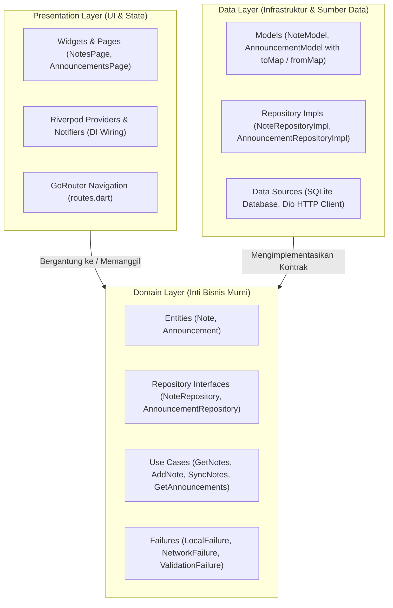
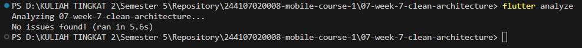
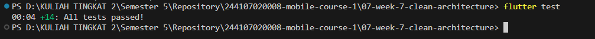
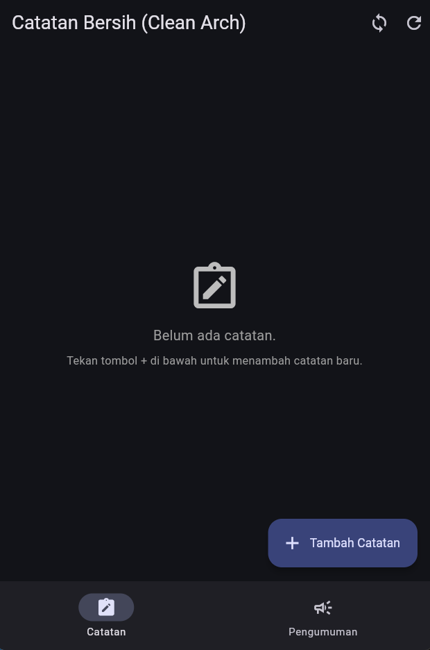
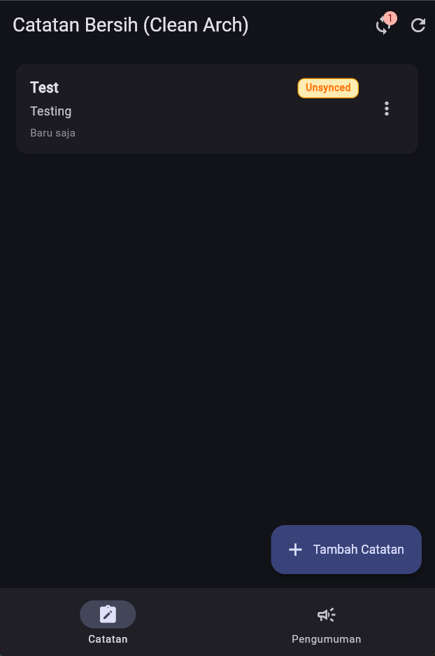
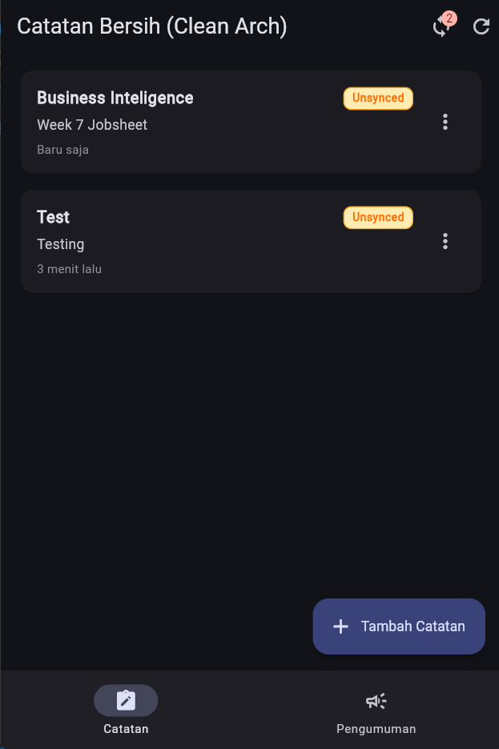
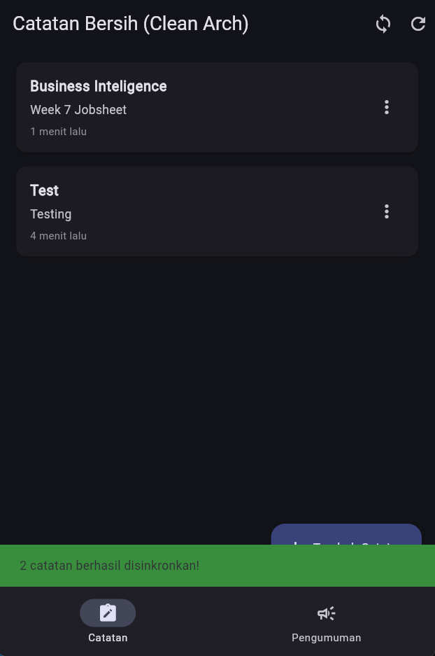
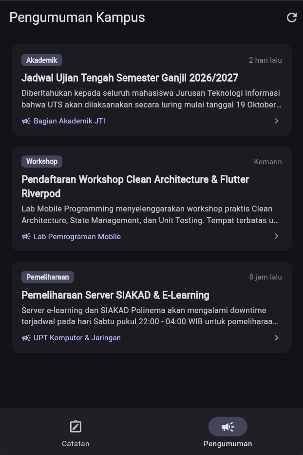
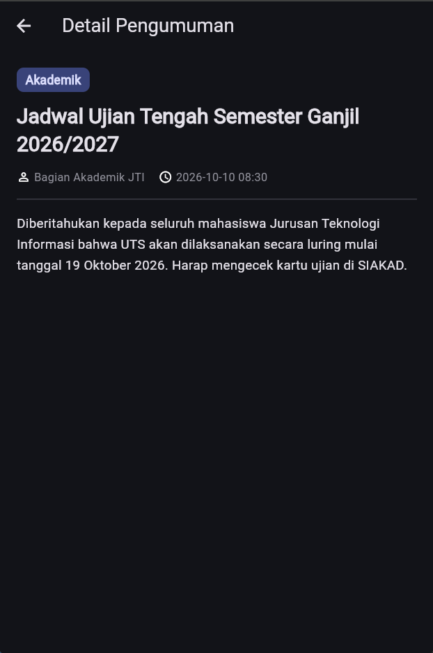

# Laporan Praktikum Minggu 7: Clean Architecture & SOLID Principles

**Mata Kuliah:** Pemrograman Mobile (Semester 5)  
**Program Studi:** D-IV Teknik Informatika, Jurusan Teknologi Informasi  
**Politeknik Negeri Malang**

---

## 👤 Identitas Mahasiswa

* **Nama:** Aditya Rizqiqa Ramadhan
* **NIM:** 244107020008
* **Kelas:** TI-3E
* **Tautan Jobsheet:** [Modul Resmi Codelab Minggu 7](https://jti-polinema.github.io/flutter-codelab/07-minggu-7-clean-architecture/index.html#0)

---

## 🎯 Tujuan Pembelajaran

Setelah menyelesaikan praktikum pada modul ini, mahasiswa mampu:
1. Menjelaskan prinsip **SOLID** dan *separation of concerns* melalui arsitektur nyata kode Flutter.
2. Membedakan struktur **feature-first** vs **layer-first** beserta kelebihan dan trade-off-nya.
3. Menjelaskan tiga layer utama (*Presentation*, *Domain*, *Data*) dan **Dependency Rule** (dependensi mutlak mengarah ke dalam).
4. Membedakan peran **Entity** vs **Model**, serta fungsi **Repository Interface**, **Use Case**, dan **Dependency Injection**.
5. Merefactor codebase project menjadi arsitektur bersih (*Clean Architecture*) modular berbasis fitur.
6. Menguji logika bisnis (*Use Case*) menggunakan repository palsu (*fake/mock*) secara deterministik tanpa ketergantungan pada SQLite fisik maupun jaringan internet.

---

## 📐 Diagram Clean Architecture & Aturan Dependensi

Aturan emas (*The Dependency Rule*): **Dependensi hanya mengarah ke dalam**. Layer *Domain* adalah pusat bisnis murni yang tidak mengenal detail teknologi (Flutter Widget, HTTP/Dio, SQLite, atau Firebase).



---

## 🏛️ Prinsip SOLID dalam Flutter

| Prinsip | Definisi Praktis | Gejala Pelanggaran di Flutter | Solusi Clean Architecture |
|---|---|---|---|
| **S** - Single Responsibility | Satu kelas hanya memiliki satu alasan untuk berubah. | Widget 400 baris yang sekaligus fetch API, query SQLite, parsing JSON, dan memformat tanggal. | Widget hanya menampilkan UI; logika diisolasi di Use Case/Notifier, dan data di Data Source. |
| **O** - Open/Closed | Terbuka untuk ekstensi, tertutup untuk modifikasi. | Menambah sumber data baru (misal: Cloud Sync) memaksa pengubahan kode widget yang sudah berjalan. | Tambahkan implementasi repository baru yang mengimplementasikan interface domain yang sama tanpa menyentuh UI. |
| **L** - Liskov Substitution | Subtipe harus dapat menggantikan tipe dasarnya tanpa merusak sistem. | Fake Repository untuk unit test melempar exception tak terduga yang tidak pernah dilempar repository asli. | Fake Repository mematuhi kontrak record `({T? data, Failure? failure})` secara identik. |
| **I** - Interface Segregation | Jangan paksa klien bergantung pada antarmuka yang tidak mereka gunakan. | Satu antarmuka raksasa `AppRepository` berisi auth, notes, push, dan profile sekaligus. | Pisahkan kontrak per fitur: `NoteRepository` dan `AnnouncementRepository`. |
| **D** - Dependency Inversion | Modul tingkat tinggi tidak boleh bergantung pada modul tingkat rendah; keduanya bergantung pada abstraksi. | State Notifier memanggil kelas konkret `Dio` atau `openDatabase` secara langsung. | Notifier dan Use Case hanya bergantung pada interface abstrak `NoteRepository`. |

---

## 📚 Kosakata Peran (Roles)

* **Entity:** Objek bisnis murni tanpa anotasi serialisasi (`toMap`, `fromMap`, `toJson`). Terletak di `domain/entities/`.
* **Model:** Representasi data eksternal (Database/JSON) yang mewarisi Entity ditambah fungsi mapping. Terletak di `data/models/`.
* **Repository Interface:** Kontrak abstrak yang mendefinisikan operasi data yang dibutuhkan domain. Terletak di `domain/repositories/`.
* **Repository Implementation:** Kelas konkret yang mengimplementasikan interface memakai driver nyata (SQLite, Dio, SharedPrefs). Terletak di `data/repositories/`.
* **Use Case:** Satu operasi bisnis spesifik (contoh: `GetNotes`, `AddNote`, `GetAnnouncements`). Terletak di `domain/usecases/`.
* **Dependency Injection (DI):** Pola penyuntikan dependensi yang terpusat pada provider Riverpod tanpa instansiasi manual (`new`) di dalam UI.

---

## 📂 Struktur Proyek Feature-First (`07-week-7-clean-architecture`)

Proyek disusun dengan pendekatan **Feature-First** modular:

```text
07-week-7-clean-architecture/
├── lib/
│   ├── main.dart                                  # Entrypoint & ProviderScope
│   ├── routes.dart                                # GoRouter & Navigasi Antar Fitur
│   ├── core/                                      # Komponen Inti Murni Lintas Fitur
│   │   ├── failures.dart                          # Sealed Failure Hierarchy (Murni Dart)
│   │   └── format.dart                            # Fungsi Murni Format Tanggal & Parse Rute
│   └── features/
│       ├── notes/                                 # FITUR 1: Catatan Lokal & Sync
│       │   ├── domain/                            # [Domain Layer] Murni Dart
│       │   │   ├── entities/note.dart             # Entity Note
│       │   │   ├── repositories/note_repository.dart # Interface Kontrak
│       │   │   └── usecases/
│       │   │       ├── get_notes.dart             # Use Case Baca Catatan
│       │   │       ├── add_note.dart              # Use Case Tambah Catatan (dengan validasi)
│       │   │       ├── update_note.dart           # Use Case Edit Catatan
│       │   │       ├── delete_note.dart           # Use Case Hapus Catatan
│       │   │       └── sync_notes.dart            # Use Case Sinkronisasi Status Dirty
│       │   ├── data/                              # [Data Layer] SQLite & Mapping
│       │   │   ├── models/note_model.dart         # Model dengan toMap & fromMap
│       │   │   ├── datasources/note_db.dart       # SQLite Database Opener
│       │   │   └── repositories/note_repository_impl.dart # Implementasi Konkret
│       │   └── presentation/                      # [Presentation Layer] UI & State
│       │       ├── providers/notes_providers.dart # Riverpod DI Wiring & State Provider
│       │       └── pages/notes_page.dart          # UI Catatan, Dialog Modal & SnackBar
│       └── announcements/                         # FITUR 2: Pengumuman Kampus (Refactoring Challenge)
│           ├── domain/
│           │   ├── entities/announcement.dart     # Entity Pengumuman
│           │   ├── repositories/announcement_repository.dart # Interface Kontrak
│           │   └── usecases/
│           │       ├── get_announcements.dart     # Use Case Daftar Pengumuman
│           │       └── get_announcement_detail.dart # Use Case Detail (validasi ID)
│           ├── data/
│           │   ├── models/announcement_model.dart # Model Pengumuman
│           │   └── repositories/announcement_repository_impl.dart # Impl Jaringan/Dio
│           └── presentation/
│               ├── providers/announcement_providers.dart # Riverpod DI Wiring
│               └── pages/
│                   ├── announcements_page.dart    # UI List Berita & Kategori Chips
│                   └── announcement_detail_page.dart # UI Detail Berita & Deep Link
├── test/
│   ├── get_notes_test.dart                        # Unit Test Use Case Note dengan Fake Repo
│   ├── announcements_test.dart                    # Unit Test Use Case Announcement
│   ├── core_format_test.dart                      # Test Fungsi Murni Format & Parse Rute
│   └── widget_test.dart                           # App Smoke Test Navigation
├── docs/
│   ├── ai_challenge.md                            # Laporan Lengkap Prompt AI & Verification Checklist
│   └── audit_layer.md                             # Laporan Audit Layer & Bukti Sterilitas Grep
├── screenshots/                                   # Folder Bukti Tangkapan Layar Pengujian
│   ├── 01-notes-page-clean.png                    # Tampilan awal daftar catatan bersih
│   ├── 02-add-note-dialog.png                     # Dialog form tambah catatan
│   ├── 03-notes-with-dirty-badge.png              # Catatan baru dengan badge unsynced
│   ├── 04-sync-action-success.png                 # Konfirmasi SnackBar sukses sync
│   ├── 05-announcement-list.png                   # Daftar pengumuman kampus
│   ├── 06-announcement-detail.png                 # Detail pengumuman & deep link
│   ├── 07-flutter-analyze-clean.png               # Hasil flutter analyze bersih
│   └── 08-flutter-analyze-passed.png              # Hasil seluruh unit test lulus
├── pubspec.yaml                                   # Dependensi Paket (Riverpod, GoRouter, Sqflite, Dio)
└── README.md                                      # Laporan Resmi Praktikum Minggu 7
```

---

## 🔍 Bukti Sterilitas Arsitektur (Verifikasi Tiga Grep)

Sesuai instruksi Praktikum 3 Codelab, dilakukan 3 pemeriksaan sterilitas dependensi:

### 1. Presentation Steril dari Data Mentah (Target: 0 Hasil)
Pencarian pemanggilan driver data mentah (`Dio`, `openDatabase`, `getDatabasesPath`, `FlutterSecureStorage`, `SharedPreferences`, `jsonDecode`) di folder Presentation:
```powershell
Select-String -Pattern 'Dio\(|openDatabase|getDatabasesPath|FlutterSecureStorage|SharedPreferences\.getInstance|jsonDecode' -Path 'lib/features/*/presentation/**/*.dart'
```
* **Hasil:** **0 Temuan (Lolos 100%)**

### 2. Domain Steril dari Framework & Driver (Target: 0 Hasil)
Pencarian import package Flutter, Dio, SQLite, atau Firebase pada folder Domain dan Core:
```powershell
Select-String -Pattern "import 'package:flutter|import 'package:dio|import 'package:sqflite|import 'package:firebase" -Path @('lib/features/*/domain/**/*.dart', 'lib/core/**/*.dart')
```
* **Hasil:** **0 Temuan (Lolos 100%)**

### 3. Tidak Ada Instansiasi Manual (DI Bocor) di UI (Target: 0 Hasil)
Pencarian instansiasi langsung repository di dalam presentation pages:
```powershell
Select-String -Pattern 'Repository\(|Dio\(BaseOptions' -Path 'lib/features/*/presentation/pages/**/*.dart'
```
* **Hasil:** **0 Temuan (Lolos 100%)**

---

## 🧪 Hasil Verifikasi Static Analysis & Pengujian Otomatis

### 1. `flutter analyze`
```text
Analyzing 07-week-7-clean-architecture...
No issues found! (ran in 4.5s)
```
Proyek 100% bebas dari peringatan linter, error tipe, dan bad practices.

### 2. `flutter test`
```text
00:00 +0: Announcement Use Cases Tests GetAnnouncements mengembalikan seluruh daftar pengumuman
00:00 +1: Announcement Use Cases Tests GetAnnouncements meneruskan NetworkFailure saat terjadi kegagalan jaringan
00:00 +2: Announcement Use Cases Tests GetAnnouncementDetail mengembalikan detail yang cocok dengan ID
00:00 +3: Announcement Use Cases Tests GetAnnouncementDetail menolak ID non-positif dengan ValidationFailure
00:00 +4: Announcement Use Cases Tests GetAnnouncementDetail mengembalikan NotFoundFailure jika ID tidak ditemukan
00:00 +5: Core Format & Parsing Pure Function Tests formatDate memformat DateTime dengan padding nol yang tepat
00:00 +6: Core Format & Parsing Pure Function Tests formatRelativeDate menghasilkan teks waktu relatif yang benar
00:00 +7: Core Format & Parsing Pure Function Tests parseIdFromRoute mengekstrak ID integer dari rute
00:00 +8: Core Format & Parsing Pure Function Tests parseRouteParam mengekstrak nilai placeholder dengan tepat
00:00 +9: GetNotes Use Case Tests GetNotes meneruskan daftar dari repository
00:00 +10: GetNotes Use Case Tests GetNotes meneruskan failure tanpa melempar
00:00 +11: AddNote Use Case Validation & Execution Tests AddNote menolak input judul kosong dengan ValidationFailure
00:00 +12: AddNote Use Case Validation & Execution Tests AddNote berhasil menambahkan catatan dengan judul valid
00:06 +13: App smoke test loads Clean Architecture navigation
00:07 +14: All tests passed!
```
Seluruh 14 skenario pengujian unit test dan widget smoke test **berhasil lulus 100%**.

---

## 🤖 Ringkasan AI Challenge & Verifikasi Kritis

Dokumentasi detail tersimpan pada [docs/ai_challenge.md](file:///d:/KULIAH%20TINGKAT%202/Semester%205/Repository/244107020008-mobile-course-1/07-week-7-clean-architecture/docs/ai_challenge.md).

* **Evaluasi Kritis Terhadap Saran AI:**
  1. AI mengusulkan use case untuk semua fungsi CRUD sederhana satu baris. Kami menyaringnya: operasi tanpa logika bisnis boleh langsung dipanggil via repository pada arsitektur berskala kecil, tetapi use case diwajibkan bila terdapat validasi domain (seperti validasi judul kosong pada `AddNote` dan validasi ID positif pada `GetAnnouncementDetail`).
  2. Entity dipastikan murni tanpa anotasi JSON/Database serialisasi.
  3. Seluruh wiring dependency injection dipusatkan pada Riverpod provider tanpa library pihak ketiga (`get_it`), menjaga kemudahan testing melalui mekanisme `provider.overrideWithValue`.

---

## 📝 Refleksi Praktikum

### 1. Mengapa interface repository harus tinggal di domain, bukan di data? Apa yang rusak bila dibalik?
Jika interface repository diletakkan di layer `data`, maka layer `domain` harus mengimpor layer `data` untuk mengetahui tipe repository tersebut. Hal ini melanggar aturan emas dependensi (*Dependency Rule*): domain (logika bisnis tingkat tinggi) menjadi bergantung pada data (implementasi teknis tingkat rendah). Konsekuensinya, logika bisnis tidak lagi independen dari framework/database, pengujian unit murni tanpa mock data layer menjadi sulit, dan setiap perubahan infrastruktur data berpotensi merusak domain. Dengan menempatkan interface di `domain`, prinsip **Dependency Inversion** terpenuhi: domain mendikte kebutuhan kontraknya, dan layer `data` bertindak sebagai penyedia yang tunduk pada kontrak tersebut.

### 2. Kapan use case benar-benar dibutuhkan, dan kapan repository langsung ke notifier sudah cukup?
Use Case benar-benar dibutuhkan ketika:
- Suatu operasi bisnis melibatkan validasi aturan domain sebelum data disimpan atau diambil (misalnya: memvalidasi bahwa judul catatan tidak boleh kosong atau tanggal tidak boleh lampau).
- Operasi menggabungkan lebih dari satu repository (misalnya: membaca token dari `AuthRepository` lalu mengambil data catatan dari `NoteRepository`).
- Terdapat aturan transformasi atau orkestrasi data yang harus independen dari UI framework.

Sebaliknya, pemanggilan repository langsung ke notifier sudah cukup pada operasi **CRUD satu baris tanpa aturan bisnis** (passthrough sederhana), karena membungkusnya ke Use Case baru hanya menambah boilerplate tanpa manfaat nyata.

### 3. Apa biaya over-engineering (use case per CRUD satu-baris) bagi tim kecil? Kapan biayanya sepadan?
Biaya over-engineering (*cost of over-engineering*) bagi tim kecil adalah:
- Terjadinya ledakan jumlah file (*class explosion*), meningkatkan beban kognitif developer dalam membaca dan menavigasi kode.
- Waktu pengembangan (*development velocity*) menjadi lebih lambat akibat banyaknya boilerplate kode yang harus dibuat untuk fitur sederhana.
Biaya tersebut menjadi sepadan (*worth the trade-off*) ketika aplikasi mulai tumbuh besar, dikerjakan oleh banyak tim paralel, memerlukan unit test logika bisnis yang sangat ketat (*critical business logic*), atau ketika sumber data sering berganti (misal: migrasi dari SQLite lokal ke GraphQL / Firebase Cloud).

### 4. Bagian mana dari usulan AI yang Anda tolak atau sederhanakan, dan mengapa?
Kami menolak usulan AI yang ingin membuat use case terpisah untuk setiap delegasi satu-baris murni tanpa logika (seperti `FetchNotesDirect` yang hanya meneruskan fungsi). Kami menyederhanakannya dengan mempertahankan Use Case terfokus yang memuat validasi dan orkestrasi nyata (`AddNote`, `UpdateNote`, `GetAnnouncementDetail`, `SyncNotes`). Kami juga menolak ide AI yang menyarankan impor page lintas fitur, dan menggantikannya dengan navigasi terpisah yang bersih via `go_router` dan `ShellRoute` pada [routes.dart](file:///d:/KULIAH%20TINGKAT%202/Semester%205/Repository/244107020008-mobile-course-1/07-week-7-clean-architecture/lib/routes.dart).

---

## 📷 Lampiran Dokumentasi & Hasil Tangkapan Layar (Screenshots)

Berikut adalah dokumentasi tangkapan layar hasil implementasi, pengujian statis, dan eksekusi fitur aplikasi Clean Architecture yang tersimpan pada folder [screenshots/](file:///d:/KULIAH%20TINGKAT%202/Semester%205/Repository/244107020008-mobile-course-1/07-week-7-clean-architecture/screenshots/):

### A. Pengujian Otomatis & Analisis Kode (CLI Verification)

| Pengujian | Screenshot | Deskripsi & Hasil |
|---|---|---|
| **1. Static Analysis (`flutter analyze`)** |  | Hasil eksekusi `flutter analyze` yang menunjukkan status `No issues found!`. Proyek 100% bebas dari error maupun peringatan linter. |
| **2. Unit & Widget Test Suite (`flutter test`)** |  | Hasil eksekusi `flutter test` yang membuktikan seluruh 14 skenario unit test & widget smoke test lulus (`All tests passed!`). |

---

### B. Fitur 1: Catatan Bersih (Clean Notes & Offline Sync)

| Skenario | Screenshot | Deskripsi Fitur |
|---|---|---|
| **1. Tampilan Awal Catatan Bersih** |  | Halaman utama `NotesPage` steril dari driver data mentah, me-watch provider Riverpod `notesProvider`, menampilkan empty state dan tombol tambah (+). |
| **2. Dialog Tambah Catatan Baru** |  | Modal dialog input catatan baru yang terhubung ke Use Case `AddNote` lengkap dengan validasi domain (menolak judul kosong). |
| **3. Catatan Baru dengan Status Unsynced (Dirty Flag)** |  | Catatan baru yang tersimpan di SQLite lokal otomatis ditandai `dirty = true` (badge kuning *Unsynced*), dan badge counter sync di AppBar bertambah menjadi `1`. |
| **4. Hasil Eksekusi Sinkronisasi Data** |  | Pengguna menekan ikon sinkronisasi di AppBar; Use Case `SyncNotes` dieksekusi, flag dirty diubah menjadi 0, badge dirty hilang, dan muncul SnackBar konfirmasi hijau. |

---

### C. Fitur 2: Pengumuman Kampus (Refactoring Challenge & Deep Link)

| Skenario | Screenshot | Deskripsi Fitur |
|---|---|---|
| **1. Daftar Pengumuman Kampus** |  | Halaman `AnnouncementsPage` menampilkan kartu pengumuman dengan kategori chips (*Akademik*, *Workshop*, *Pemeliharaan*) dan format tanggal relatif murni dari `lib/core/format.dart`. |
| **2. Halaman Detail Pengumuman** |  | Tampilan detail pengumuman (`AnnouncementDetailPage`) yang dipicu dari tap kartu atau navigasi deep link `/announcements/:id`, menampilkan informasi penulis dan tanggal lengkap. |

---

## 🚀 Panduan Menjalankan Aplikasi

1. **Jalankan Pengujian Otomatis:**
   ```bash
   flutter analyze
   flutter test
   ```

2. **Jalankan Aplikasi:**
   ```bash
   flutter run -d chrome
   ```
   *(Atau jalankan pada Android Emulator melalui VS Code).*

