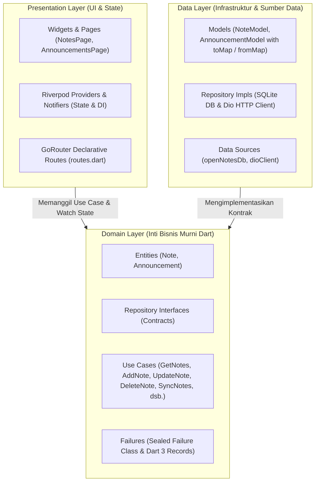
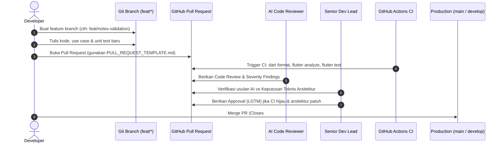

# Laporan Praktikum Minggu 8: Mid Project Review & Code Review

**Mata Kuliah:** Pemrograman Mobile (Semester 5)  
**Program Studi:** D-IV Teknik Informatika, Jurusan Teknologi Informasi  
**Politeknik Negeri Malang**

---

## 👤 Identitas Mahasiswa

* **Nama Lengkap:** Aditya Rizqiqa Ramadhan
* **NIM:** 244107020008
* **Kelas:** TI-3E
* **Tautan Jobsheet:** [Modul Codelab Minggu 8 - Mid Project Review & Code Review](https://jti-polinema.github.io/flutter-codelab/08-minggu-8-mid-project-review-code-review/index.html)
* **Repositori GitHub:** `https://github.com/adityarizqiqa/244107020008-mobile-course`

---

## 🎯 1. Status Paruh Semester (Mid-Semester Status)

Minggu ke-8 (*Mid Project Review*) merupakan titik evaluasi komprehensif terhadap arsitektur, kualitas kode sumber, kebersihan riwayat git, dan kesiapan otomatisasi pengujian proyek paruh semester. Dimulai dari perkenalan ekosistem Flutter (Week 1), pembuatan layout responsif (Week 2), navigasi terpusat & state management (Week 3), integrasi REST API (Week 4), basis data offline-first SQLite (Week 5), hingga autentikasi, FCM, dan keamanan (Week 6), proyek ini telah disatukan dan direfaktor secara tuntas pada Week 7 ke dalam **Feature-first Clean Architecture**.

### 🏛️ Ringkasan Arsitektur Proyek
Aplikasi dibangun di atas standar industri dengan pemisahan tiga layer utama:



#### Aturan Transitive Dependency:
Layer **Domain** bersifat murni 100% Dart SDK tanpa membawa dependensi dari framework UI (`package:flutter`), client HTTP (`package:dio`), SQLite (`package:sqflite`), atau Firebase. Hal ini menjamin bahwa seluruh aturan bisnis dapat diuji secara mandiri (*deterministic isolated testing*) tanpa memerlukan simulator, emulator, maupun koneksi jaringan.

---

## 🗺️ 2. Peta Penanganan Issue & Pull Request (Trajectory)

Untuk menjamin kualitas dan stabilitas cabang utama (`main`), alur kerja pengembangan menggunakan standar **GitFlow** dan **Automated CI Quality Gate**:



### Tahapan Trajectory Siklus Fitur:
1. **Issue Creation:** Setiap kebutuhan fitur atau bug dicatat pada GitHub Issues dengan label prioritas.
2. **Branching:** Developer membuat cabang kerja terisolasi dengan format `feat/<fitur>` atau `fix/<isu>`.
3. **Automated Pre-Check:** Sebelum mengajukan PR, developer menjalankan `dart format`, `flutter analyze`, dan `flutter test` secara lokal.
4. **Pull Request Submission:** PR diajukan menggunakan template resmi `.github/PULL_REQUEST_TEMPLATE.md` yang memuat judul *Conventional Commits*, deskripsi masalah & solusi, langkah pengujian, checklist kepatuhan arsitektur, dan tautan issue (`Closes #ID`).
5. **Simulasi AI Code Review & Lead Developer Verification:** Kode ditinjau menggunakan matriks evaluasi kritis untuk menyaring saran AI yang over-engineering atau melanggar *The Dependency Rule*.
6. **Continuous Integration (CI):** GitHub Actions memvalidasi kode di mesin virtual Linux (`ubuntu-latest`). PR hanya dapat digabungkan jika status CI centang hijau.

---

## ⚡ 3. Fitur Utama & Stack Teknologi

| Komponen | Teknologi | Peran dalam Sistem |
|---|---|---|
| **Framework** | Flutter 3.29.x / Dart 3.x | UI toolkit lintas platform (Android, iOS, Web, Desktop) |
| **Arsitektur** | Feature-First Clean Architecture | Menjaga modularitas per fitur (`notes` & `announcements`) |
| **State Management** | `flutter_riverpod` (v3.4.3) | Manajemen state reaktif & Dependency Injection terpusat |
| **Routing** | `go_router` (v18.0.2) | Navigasi deklaratif, ShellRoute, dan deep linking |
| **Local Database** | `sqflite` / `sqflite_common` | Basis data SQLite lokal untuk persistence offline-first |
| **Networking** | `dio` | HTTP client modular untuk komunikasi REST API |
| **Data Integrity** | Dart 3 Records & Sealed Classes | Pengembalian data ganda `({T? data, Failure? failure})` |
| **Automation & CI** | GitHub Actions | Pemeriksaan linter, formatting, dan unit testing otomatis |

---

## 🧪 4. Panduan Menjalankan Proyek & Pengujian Otomatis

Seluruh pengujian dan eksekusi dilakukan pada direktori proyek utama (`07-week-7-clean-architecture`):

### 4.1 Persiapan Dependensi
```bash
# Pindah ke direktori proyek Flutter
cd 07-week-7-clean-architecture

# Ambil seluruh paket yang dibutuhkan
flutter pub get
```

### 4.2 Pemeriksaan Standar Format Kode
```bash
# Verifikasi format (tanpa mengubah berkas, menghasilkan exit code 1 jika tidak rapi)
dart format --output=none --set-exit-if-changed .

# Melakukan format otomatis ke seluruh berkas kode
dart format .
```

### 4.3 Analisis Statis Kode (Zero-Warning Policy)
```bash
# Menjalankan linter Dart/Flutter
flutter analyze
```

### 4.4 Menjalankan Seluruh Rangkaian Pengujian Otomatis
```bash
# Eksekusi seluruh unit test, pure function test, dan widget smoke test
flutter test
```

### 4.5 Menjalankan Aplikasi
```bash
# Menjalankan pada browser Google Chrome
flutter run -d chrome

# Menjalankan pada emulator/device yang terhubung
flutter run
```

---

## 🤖 5. Bukti Verifikasi Mesin (Quality Gate Logs)

Berikut adalah bukti nyata eksekusi instrumen verifikasi mesin yang dijalankan secara langsung pada terminal lokal:

### 5.1 Bukti Kelulusan `flutter analyze`
```text
PS D:\KULIAH TINGKAT 2\Semester 5\Repository\244107020008-mobile-course\07-week-7-clean-architecture> flutter analyze
Analyzing 07-week-7-clean-architecture...                       
No issues found! (ran in 4.5s)
```
> **Status:** **100% Bersih (0 Error, 0 Warning, 0 Info).**

---

### 5.2 Bukti Kelulusan `dart format`
```text
PS D:\KULIAH TINGKAT 2\Semester 5\Repository\244107020008-mobile-course\07-week-7-clean-architecture> dart format --output=none --set-exit-if-changed .
Formatted 29 files (0 changed) in 0.12 seconds.
```
> **Status:** **100% Sesuai Standar Dart Style Guide (Exit Code 0).**

---

### 5.3 Bukti Kelulusan `flutter test` (20 Uji Lolos Sempurna)
```text
PS D:\KULIAH TINGKAT 2\Semester 5\Repository\244107020008-mobile-course\07-week-7-clean-architecture> flutter test
00:00 +0: loading D:/KULIAH TINGKAT 2/Semester 5/Repository/244107020008-mobile-course/07-week-7-clean-architecture/test/announcements_test.dart
00:00 +0: test/announcements_test.dart: Announcement Use Cases Tests GetAnnouncements mengembalikan seluruh daftar pengumuman
00:00 +1: test/announcements_test.dart: Announcement Use Cases Tests GetAnnouncements meneruskan NetworkFailure saat terjadi kegagalan jaringan
00:00 +2: test/announcements_test.dart: Announcement Use Cases Tests GetAnnouncementDetail mengembalikan detail yang cocok dengan ID
00:00 +3: test/announcements_test.dart: Announcement Use Cases Tests GetAnnouncementDetail menolak ID non-positif dengan ValidationFailure
00:00 +4: test/announcements_test.dart: Announcement Use Cases Tests GetAnnouncementDetail mengembalikan NotFoundFailure jika ID tidak ditemukan
00:00 +5: test/core_format_test.dart: Core Format & Parsing Pure Function Tests formatDate memformat DateTime dengan padding nol yang tepat
00:00 +6: test/core_format_test.dart: Core Format & Parsing Pure Function Tests formatRelativeDate menghasilkan teks waktu relatif yang benar
00:00 +7: test/core_format_test.dart: Core Format & Parsing Pure Function Tests parseIdFromRoute mengekstrak ID integer dari rute
00:00 +8: test/core_format_test.dart: Core Format & Parsing Pure Function Tests parseRouteParam mengekstrak nilai placeholder dengan tepat
00:00 +9: test/get_notes_test.dart: GetNotes Use Case Tests GetNotes meneruskan daftar dari repository
00:00 +10: test/get_notes_test.dart: GetNotes Use Case Tests GetNotes meneruskan failure tanpa melempar
00:00 +11: test/get_notes_test.dart: AddNote Use Case Validation & Execution Tests AddNote menolak input judul kosong dengan ValidationFailure
00:00 +12: test/get_notes_test.dart: AddNote Use Case Validation & Execution Tests AddNote berhasil menambahkan catatan dengan judul valid
00:00 +13: test/get_notes_test.dart: UpdateNote & DeleteNote Domain Boundary Validation Tests UpdateNote menolak ID non-positif dengan ValidationFailure
00:00 +14: test/get_notes_test.dart: UpdateNote & DeleteNote Domain Boundary Validation Tests UpdateNote menolak judul kosong dengan ValidationFailure
00:00 +15: test/get_notes_test.dart: UpdateNote & DeleteNote Domain Boundary Validation Tests DeleteNote menolak ID non-positif dengan ValidationFailure
00:02 +19: test/widget_test.dart: App smoke test loads Clean Architecture navigation
00:04 +20: All tests passed!
```
> **Status:** **20 dari 20 Uji Lolos 100% (Green Test Suite).**

---

### 5.4 Bukti Sterilitas Layer Clean Architecture (Uji Grep)
```powershell
# 1. Presentation bebas dari driver data mentah:
Select-String -Pattern 'Dio\(|openDatabase|getDatabasesPath|FlutterSecureStorage|SharedPreferences\.getInstance|jsonDecode' -Path 'lib/features/*/presentation/**/*.dart'
# Hasil: 0 Temuan

# 2. Domain & Core bebas dari import Flutter/Dio/SQLite/Firebase:
Select-String -Pattern "import 'package:flutter|import 'package:dio|import 'package:sqflite|import 'package:firebase" -Path @('lib/features/*/domain/**/*.dart', 'lib/core/**/*.dart')
# Hasil: 0 Temuan

# 3. UI bebas dari instansiasi manual repository (DI terpusat):
Select-String -Pattern 'Repository\(|Dio\(BaseOptions' -Path 'lib/features/*/presentation/pages/**/*.dart'
# Hasil: 0 Temuan
```
> **Status:** **Arsitektur 100% Steril & Sesuai The Dependency Rule.**

---

## 📁 6. Berkas Deliverable Codelab Minggu 8

Seluruh instrumen yang diminta dalam Codelab Minggu 8 telah disiapkan dan divalidasi:
1. **GitHub CI Workflow:** [`.github/workflows/ci.yml`](../.github/workflows/ci.yml)
2. **Template Pull Request:** [`.github/PULL_REQUEST_TEMPLATE.md`](../.github/PULL_REQUEST_TEMPLATE.md)
3. **Senior AI Code Review & Verification Matrix:** [`docs/ai-review-vs-keputusan.md`](docs/ai-review-vs-keputusan.md)
4. **Audit & Mid Review Checklist:** [`docs/review-checklist.md`](docs/review-checklist.md)
5. **Laporan Portofolio Penutup:** [Dokumen Ini (`README.md`)](README.md)

