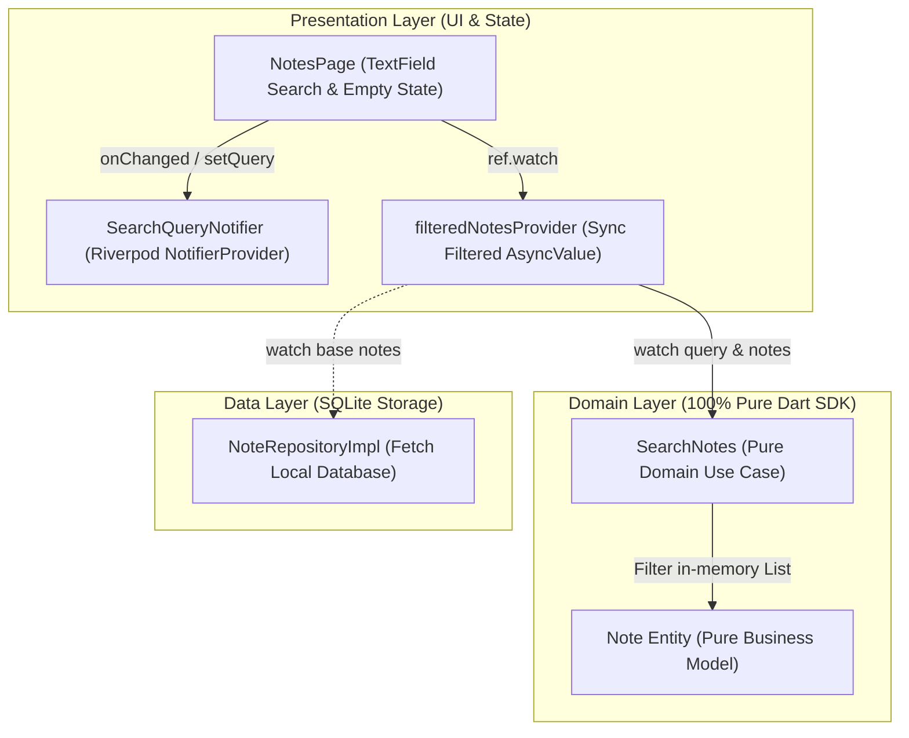
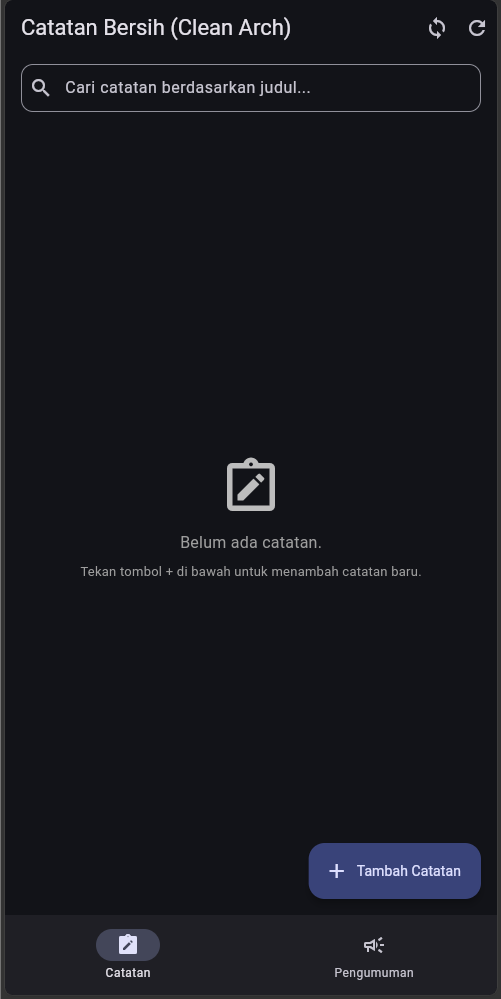
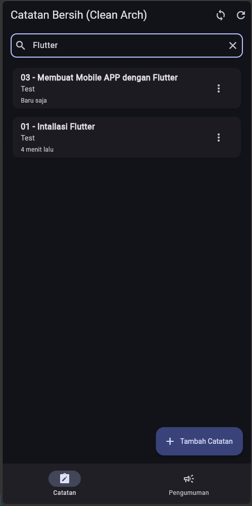
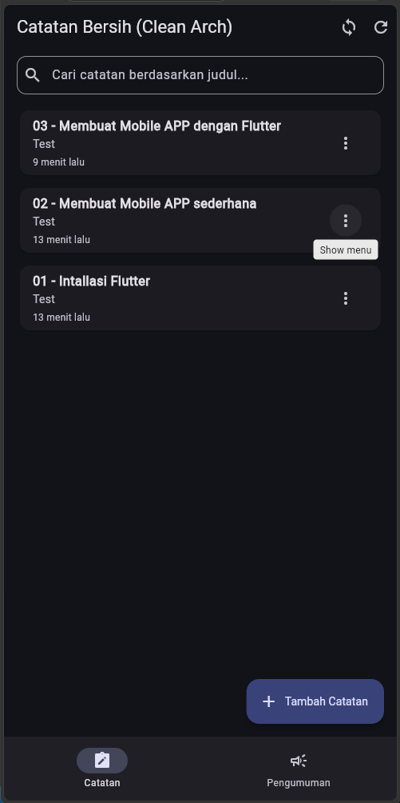

# Laporan Praktikum Minggu 9: AI-Assisted Development & Vibe Coding

**Mata Kuliah:** Pemrograman Mobile (Semester 5)  
**Program Studi:** D-IV Teknik Informatika, Jurusan Teknologi Informasi  
**Politeknik Negeri Malang**

---

## 👤 Identitas Mahasiswa

* **Nama Lengkap:** Aditya Rizqiqa Ramadhan
* **NIM:** 244107020008
* **Kelas:** TI-3E
* **Tautan Jobsheet:** [Modul Codelab Minggu 9 - AI-Assisted Development / Vibe Coding](https://jti-polinema.github.io/flutter-codelab/09-minggu-9-ai-assisted-development-vibe-coding/index.html)
* **Repositori GitHub:** `https://github.com/adityarizqiqa/244107020008-mobile-course`

---

## 🎯 1. Deskripsi Praktikum

Pada praktikum Minggu 9, mahasiswa menerapkan paradigma **AI-Assisted Development** dan **Vibe Coding** secara terstruktur, terukur, dan bertanggung jawab (*Human-in-the-Loop*). AI Coding Assistant dimanfaatkan untuk membantu implementasi fitur baru tanpa mengorbankan integritas arsitektur perangkat lunak yang telah dibangun sejak awal semester.

Fitur yang ditambahkan pada modul ini adalah **Pencarian Catatan (*Real-Time Search*) Berdasarkan Judul (`title`)** pada halaman `NotesPage` dengan tetap mematuhi prinsip **Feature-First Clean Architecture**, manajemen state modern **Riverpod 3.x**, dan pengujian otomatis komprehensif (*Unit Test & Widget Test*).

---

## 🏛️ 2. Desain Arsitektur & Kepatuhan Batasan

Implementasi fitur search mematuhi aturan ketat arsitektur:



### Prinsip Utama yang Dipenuhi:
1. **The Dependency Rule:** Berkas [`lib/features/notes/domain/usecases/search_notes.dart`](lib/features/notes/domain/usecases/search_notes.dart) 100% murni Dart SDK. Tidak ada impor `package:flutter/...`, `sqflite`, maupun `dio`.
2. **Zero Database Lag (In-Memory Filtering):** Filter pencarian dieksekusi secara sinkron di memori melalui `filteredNotesProvider`. Setiap ketikan huruf pengguna (*keystroke*) tidak memicu query lambat ke SQLite, melainkan langsung memfilter daftar entitas yang telah dimuat.
3. **Kesesuaian Riverpod 3.x:** State query dikelola dengan kelas `SearchQueryNotifier extends Notifier<String>` yang di-wire melalui `NotifierProvider` resmi Riverpod 3.x (menggantikan `StateProvider` yang telah dihapus).
4. **Batas Ukuran Kode Modular:**
   - Seluruh berkas baru berukuran **< 80 baris** (`search_notes.dart` = 20 baris, `search_notes_test.dart` = 62 baris, `notes_search_widget_test.dart` = 50 baris).
   - Seluruh method/fungsi berukuran **< 40 baris** (rendering empty state dipisah menjadi `_buildEmptyState`, `_buildSearchEmptyState`, dan `_buildInitialEmptyState`).

---

## 📱 3. Hasil Pengujian Manual & Bukti Tangkapan Layar

Pengujian dilakukan untuk membuktikan fungsionalitas pencarian real-time dan transisi antarmuka empty state:

### Skenario 1: Query Kosong (Initial State)
* **Kondisi:** Kotak pencarian dalam keadaan kosong (`""`).
* **Hasil:** Seluruh daftar catatan dari basis data lokal ditampilkan secara lengkap, dan tombol reset/clear (`X`) tidak muncul pada TextField.
* **Tangkapan Layar:**  
  

---

### Skenario 2: Filter Pencocokan Real-Time (Case-Insensitive & Spasi)
* **Kondisi:** Pengguna mengetikkan kata kunci dengan huruf kapital acak dan spasi berlebih, misalnya `"   FLUTTER   "`.
* **Hasil:** Sistem langsung memfilter catatan secara real-time dan hanya menampilkan kartu catatan yang memuat kata `"flutter"` pada judulnya. Tombol clear (`X`) muncul di sebelah kanan input.
* **Tangkapan Layar:**  
  

---

### Skenario 3: Filter Ketidakcocokan (Search Empty State)
* **Kondisi:** Pengguna mengetikkan kata kunci yang tidak terdapat pada judul catatan mana pun (misal: `"xyz123"`).
* **Hasil:** Daftar kartu catatan disembunyikan dan digantikan dengan tampilan *Search Empty State*:
  - Ikon `Icons.search_off_rounded`.
  - Judul tebal `"Tidak ada catatan ditemukan"`.
  - Pesan keterangan rincian query.
  - Tombol aksi `"Reset Pencarian"` yang jika ditekan akan mengosongkan input dan mengembalikan seluruh daftar catatan.
* **Tangkapan Layar:**  
  

---

## 🧪 4. Hasil Verifikasi Mesin (Automated Quality Gates)

Seluruh instrumen pengujian otomatis lulus dengan status bersih (*clean*):

### 1. Standar Format Kode (`dart format`)
```text
PS 09-week-9-ai-assisted-development> dart format --output=none --set-exit-if-changed .
Formatted 32 files (0 changed) in 0.10 seconds.
```
> **Status:** **100% Sesuai Dart Style Guide (Exit Code 0).**

### 2. Analisis Statis Kode (`flutter analyze`)
```text
PS 09-week-9-ai-assisted-development> flutter analyze
Analyzing 09-week-9-ai-assisted-development...                  
No issues found! (ran in 5.6s)
```
> **Status:** **0 Issues Found (0 Error, 0 Warning, 0 Info).**

### 3. Suite Pengujian Otomatis (`flutter test`)
```text
PS 09-week-9-ai-assisted-development> flutter test
00:00 +0: test/search_notes_test.dart: Pencarian sukses: case-insensitive dan spasi berlebih cocok
00:00 +1: test/search_notes_test.dart: Pencarian kosong: query tidak cocok mengembalikan list kosong []
00:00 +2: test/search_notes_test.dart: Query kosong mengembalikan seluruh daftar catatan asli
00:01 +19: test/notes_search_widget_test.dart: Menampilkan search empty state saat query tidak cocok dengan catatan apa pun
00:06 +24: All tests passed!
```
> **Status:** **24 dari 24 Test Lolos Sempurna (100% Green).**

---

## 🛠️ 5. Panduan Menjalankan Proyek di CLI

```bash
# 1. Pindah ke direktori modul Week 9
cd 09-week-9-ai-assisted-development

# 2. Mengunduh dependensi package
flutter pub get

# 3. Verifikasi format kode
dart format --output=none --set-exit-if-changed .

# 4. Menjalankan linter static analysis
flutter analyze

# 5. Menjalankan seluruh pengujian unit & widget
flutter test

# 6. Menjalankan aplikasi di Google Chrome
flutter run -d chrome
```

---

## 📝 6. Catatan Log AI & Keputusan Verifikasi

Dokumentasi lengkap mengenai interaksi perintah AI, iterasi perbaikan Riverpod 3.x, dan validasi arsitektur dapat ditinjau pada dokumen:  
[`docs/ai-log.md`](docs/ai-log.md)

