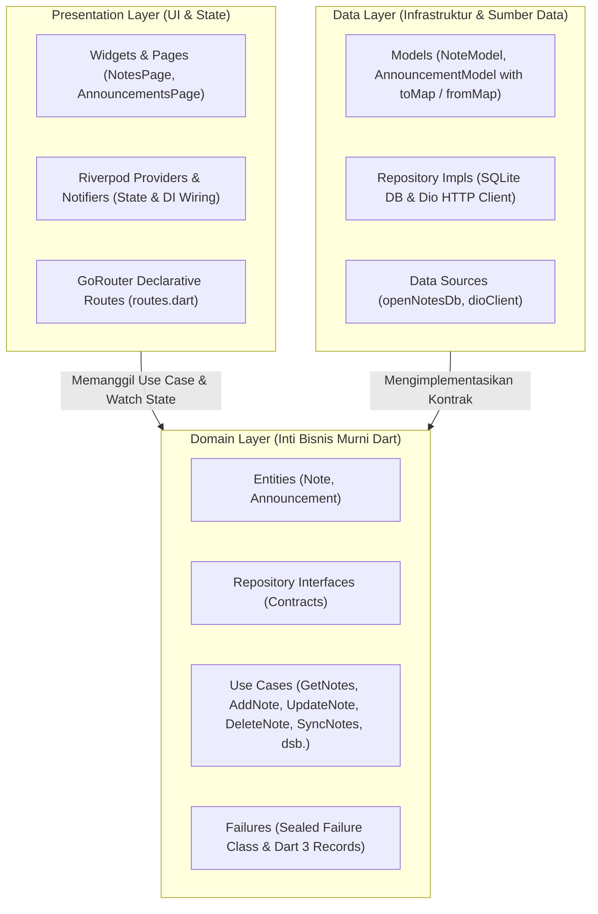

# 📱 Repositori Pembelajaran Pemrograman Mobile

**Mata Kuliah:** Pemrograman Mobile (Semester 5)  
**Program Studi:** D-IV Teknik Informatika  
**Jurusan:** Teknologi Informasi, Politeknik Negeri Malang  

---

## 👤 Identitas Pengembang

* **Nama Lengkap:** Aditya Rizqiqa Ramadhan
* **NIM:** 244107020008
* **Kelas:** TI-3E
* **Repositori:** `https://github.com/adityarizqiqa/244107020008-mobile-course`

---

## 🌟 Ringkasan Capaian Paruh Semester (Mid Project Review - Week 8)

Repositori ini merekam perkembangan pembelajaran praktikum pemrograman aplikasi *mobile* multi-platform berbasis Flutter dan Dart, mulai dari dasar antarmuka pengguna hingga arsitektur tingkat lanjut berskala *enterprise*.

Pada evaluasi tengah semester (**Minggu 8: Mid Project Review & Code Review**), proyek telah berhasil mengadopsi standar arsitektur dan kualitas perangkat lunak modern:
1. **Feature-First Clean Architecture:** Pemisahan ketat antara layer *Presentation*, *Domain*, dan *Data* dengan aturan ketergantungan mengarah ke dalam (*The Dependency Rule*).
2. **State Management & Routing:** Menggunakan kombinasi reaktif `flutter_riverpod` (v3.4.3) dan navigasi terpusat `go_router` (v18.0.2).
3. **Data Layer Offline-First:** Manajemen basis data lokal SQLite (`sqflite`) yang mendukung sinkronisasi perubahan (*dirty flags*) serta integrasi REST API (`dio`).
4. **Automated CI/CD Quality Gates:** Otomatisasi GitHub Actions (`.github/workflows/ci.yml`) yang memvalidasi *zero-warning linter* (`flutter analyze`), standar pemformatan resmi (`dart format`), dan 100% kelulusan suite pengujian otomatis (`flutter test`).
5. **PR & Code Review Discipline:** Template Pull Request terstruktur (`.github/PULL_REQUEST_TEMPLATE.md`), konvensi *Conventional Commits*, dan matriks verifikasi keputusan teknis Lead Developer atas rekomendasi AI (`docs/ai-review-vs-keputusan.md`).

---

## 📂 Struktur & Navigasi Modul Mingguan

Berikut adalah peta modul mingguan yang tersedia di dalam repositori:

| Direktori Modul | Topik Pembelajaran | Status |
|---|---|:---:|
| [`01-week-1-mobile-development-ecosystem-flutter-refresh`](01-week-1-mobile-development-ecosystem-flutter-refresh/) | Mobile Development Ecosystem & Flutter Refresh | Selesai |
| [`02-week-2-declarative-ui-responsive-design`](02-week-2-declarative-ui-responsive-design/) | Declarative UI & Responsive Dashboard Design | Selesai |
| [`03-week-3-navigation-state-management`](03-week-3-navigation-state-management/) | Navigation, GoRouter & State Management (Riverpod) | Selesai |
| [`04-week-4-networking-rest-api`](04-week-4-networking-rest-api/) | Networking, REST API & Dio Client with Error Handling | Selesai |
| [`05-week-5-local-storage-offline-first`](05-week-5-local-storage-offline-first/) | Local Storage SQLite & Offline-First Notes with Sync | Selesai |
| [`06-week-6-authentication-security-fcm`](06-week-6-authentication-security-fcm/) | Authentication, Secure Storage & Firebase Cloud Messaging (FCM) | Selesai |
| [`07-week-7-clean-architecture`](07-week-7-clean-architecture/) | Feature-First Clean Architecture & SOLID Principles | Selesai |
| [`08-week-8-mid-project-review`](08-week-8-mid-project-review/) | **Mid Project Review, CI/CD Pipeline & Code Review** | **Selesai (Aktif)** |
| `09-week-9-ai-assisted-development` | AI-Assisted Mobile Development | Terjadwal |
| `10-week-10-ai-feature-integration` | AI Feature Integration | Terjadwal |
| `11-week-11-performance-optimization` | Performance Profiling & Optimization | Terjadwal |
| `12-week-12-testing-quality-assurance` | Advanced Testing & Quality Assurance | Terjadwal |
| `13-week-13-ci-cd-automation` | Advanced CI/CD & Delivery Pipelines | Terjadwal |
| `14-week-14-deployment-monitoring` | Deployment, Crashlytics & App Monitoring | Terjadwal |
| `15-week-15-secure-mobile-development` | Mobile Security Hardening & Obfuscation | Terjadwal |
| `16-week-16-final-project-expo` | Final Project Exhibition & Release | Terjadwal |

---

## 🏛️ Desain Arsitektur Sistem (`07-week-7-clean-architecture`)



---

## ⚙️ Panduan Menjalankan Proyek & Pengujian Otomatis

Seluruh codebase aplikasi utama berada di direktori `07-week-7-clean-architecture`:

```bash
# 1. Masuk ke direktori proyek Flutter utama
cd 07-week-7-clean-architecture

# 2. Mengambil semua dependensi
flutter pub get

# 3. Memverifikasi pemformatan kode resmi Dart
dart format --output=none --set-exit-if-changed .

# 4. Melakukan analisis statis kode (Linter)
flutter analyze

# 5. Menjalankan seluruh pengujian otomatis (Unit, Widget, & Contract Tests)
flutter test

# 6. Menjalankan aplikasi pada Google Chrome
flutter run -d chrome
```

---

## 📊 Hasil Verifikasi Mesin & Kesiapan Rilis

- **Static Analysis (`flutter analyze`):** `No issues found!` (0 Errors, 0 Warnings).
- **Code Formatting (`dart format`):** Seluruh 29 berkas terformat 100% rapi.
- **Automated Tests (`flutter test`):** 20/20 test lolos sempurna (100% Green).
- **Sterilitas Domain Layer:** 0 import framework (`package:flutter`, `dio`, `sqflite`, `firebase`).
- **GitHub Actions CI:** Workflow aktif pada `.github/workflows/ci.yml`.

Untuk melihat rincian evaluasi dan matriks code review lengkap, silakan kunjungi direktori [**`08-week-8-mid-project-review/`**](08-week-8-mid-project-review/) dan dokumen [**`docs/ai-review-vs-keputusan.md`**](docs/ai-review-vs-keputusan.md).

